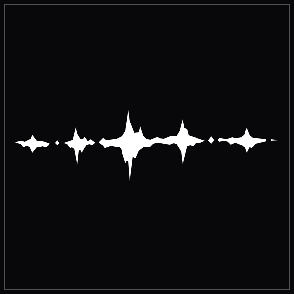

<p align="center">
  
</p>

<h1 align="center">WuWa Companion</h1>

<p align="center">
  An all-in-one pulls planner, Astrite calculator, live Waveplate tracker, and Echo farming guide for <strong>Wuthering Waves</strong> (Kuro Games).
</p>

<p align="center">
  <a href="https://blademxgit.github.io/wuwa-assistant/"></a>
  <a href="LICENSE"></a>
  
</p>

<p align="center"><a href="#english">English</a> · <a href="#español">Español</a></p>

---

## English

**WuWa Companion** is a fast, responsive, and private web toolkit built for Wuthering Waves players. It helps you manage your gacha savings, optimize character builds, track stamina in real time, and discover hidden Astrite sources across Solaris-3.

Everything runs **100% client-side** in your browser with persistent `localStorage`. No accounts, no passwords, no trackers, and no server dependencies required.

### ⚡ Core Features

1. **🎯 Pulls & Pity Planner:**
   - Real-time Astrite to Pulls conversion ($160\text{ Astrite} = 1\text{ Tide}$).
   - Pity meter with Soft Pity (65–70 pulls) and Hard Pity (80 pulls) thresholds.
   - Calculates exact pulls needed for a guaranteed character (factoring in the 50/50).
   - Banner Countdown projection: estimates how many pulls you will accumulate by day $N$ (includes Daily Activity, Lunite Subscription, and Tower of Adversity resets).
   - Highlights the 100% weapon guarantee mechanic in Wuthering Waves (no 50/50 on weapon banners).

2. **⚡ Live Waveplate (Stamina) Tracker:**
   - Real-time calculation of current Waveplate with a 1-per-6-minute recovery ticker.
   - Exact timestamp display for full $240/240$ energy recovery.
   - Quick spend (-40 World Boss, -60 Weekly/Tacet Field) and refill (+60 Crystal Solvent) buttons.

3. **🧭 Hidden Secrets & Astrite Sources:**
   - Detailed guide on one-time and recurring Astrite sources.
   - Tactical Hologram Boss challenges ($720+\text{ Astrite}$).
   - Sonance Caskets & Windchimer exploration turn-in rewards.
   - Tiger's Maw Mine secret questlines and red-aura world elite monsters.

4. **🔮 Echoes & Sonata Sets Guide:**
   - Complete breakdown of all 9 Sonata effects (Molten Rift, Sierra Gale, Celestial Light, Rejuvenating Glow, etc.) and best-fit characters.
   - Cost optimization: Meta DPS 4-3-3-1-1 vs budget 4-4-1-1 comparison.
   - Data Bank Level 20/21 tips to avoid wasting Gold Tuners.

5. **🎁 Active Promo Codes:**
   - Curated list of active redemption codes with one-click clipboard copy.
   - Step-by-step in-game redemption guide.

### 🚀 Live Web App

Access the live tool on GitHub Pages: **[https://blademxgit.github.io/wuwa-assistant/](https://blademxgit.github.io/wuwa-assistant/)**

### 💻 Run Locally

```bash
# Clone the repository
git clone https://github.com/BladeMXGit/wuwa-assistant.git
cd wuwa-assistant

# Open directly in your browser or run with python:
python -m http.server 8080
```

---

## Español

**WuWa Companion** es una suite de herramientas ligera, rápida y privada diseñada para jugadores de **Wuthering Waves**. Te permite planificar tus tiradas del gacha, optimizar la resina (Waveplate) en tiempo real, armar sets de Ecos meta y encontrar todas las fuentes secretas de Astrites en Solaris-3.

Funciona **100% en el navegador**, guardando tus datos localmente en `localStorage`. Sin registros, sin contraseñas, sin publicidad invasiva y sin backend.

### ⚡ Funcionalidades Principales

1. **🎯 Calculador de Tiradas y Pity:**
   - Conversión instantánea de Astrites a Mareas ($160\text{ Astrites} = 1\text{ Tirada}$).
   - Barra visual de Pity con marcas de Soft Pity (tiradas 65 a 70) y Hard Pity (80).
   - Cálculo del peor escenario para asegurar tu personaje (si perdiste o tienes pendiente el 50/50).
   - Proyección a futuro: calcula cuántas tiradas tendrás para cuando termine el banner actual (sumando misiones diarias, Pase Lunite y Torre de la Adversidad).
   - Recuerda la gran ventaja de WuWa: el banner de armas promocionales tiene garantía del 100% a las 80 tiradas (sin 50/50).

2. **⚡ Contador de Waveplate en Vivo:**
   - Monitor de energía con recarga automática de 1 Waveplate cada 6 minutos.
   - Cálculo de la hora y fecha exacta en la que tu energía llegará al límite ($240/240$).
   - Botones rápidos para restar gasto en Jefes (-40), Tacet Fields (-60) o recargar con Solvente Cristalino (+60).

3. **🧭 Fuentes de Astrite y Secretos Ocultos:**
   - Guía interactiva de fuentes recurrentes y secretos de exploración.
   - Desafíos de Hologramas Tácticos (hasta $720+\text{ Astrite}$ por superar los 6 niveles).
   - Entrega de Reliquias de Sonoridad y Campanillas de Viento (Mt. Firmament).
   - Misiones secretas de la Mina de las Fauces del Tigre y enemigos de aura roja de alto nivel.

4. **🔮 Guía de Ecos y Efectos de Sonata:**
   - Información de los 9 sets elementales y de soporte (Furia Ardiente, Resplandor Sanador, Nubes de Luna, etc.) con sus personajes recomendados.
   - Comparativa de distribución de costes: 4-3-3-1-1 (techo de daño óptimo) vs 4-4-1-1 (económica).
   - Consejos para el Banco de Datos (alcanzar nivel 20/21 para 100% de Ecos dorados y no malgastar sintonizadores).

5. **🎁 Códigos de Canje Activos:**
   - Lista actualizada de códigos con botón de copia con un solo clic.
   - Guía paso a paso sobre cómo canjearlos dentro del juego.

### 🚀 Aplicación Online

Prueba la aplicación online en GitHub Pages: **[https://blademxgit.github.io/wuwa-assistant/](https://blademxgit.github.io/wuwa-assistant/)**

### 💻 Ejecución en Local

```bash
# Clonar el repositorio
git clone https://github.com/BladeMXGit/wuwa-assistant.git
cd wuwa-assistant

# Abrir index.html directamente en cualquier navegador o servir con Python:
python -m http.server 8080
```

---

### 📄 Licencia

Publicado bajo la licencia de código abierto [MIT](LICENSE). Wuthering Waves es una marca registrada de Kuro Games.
